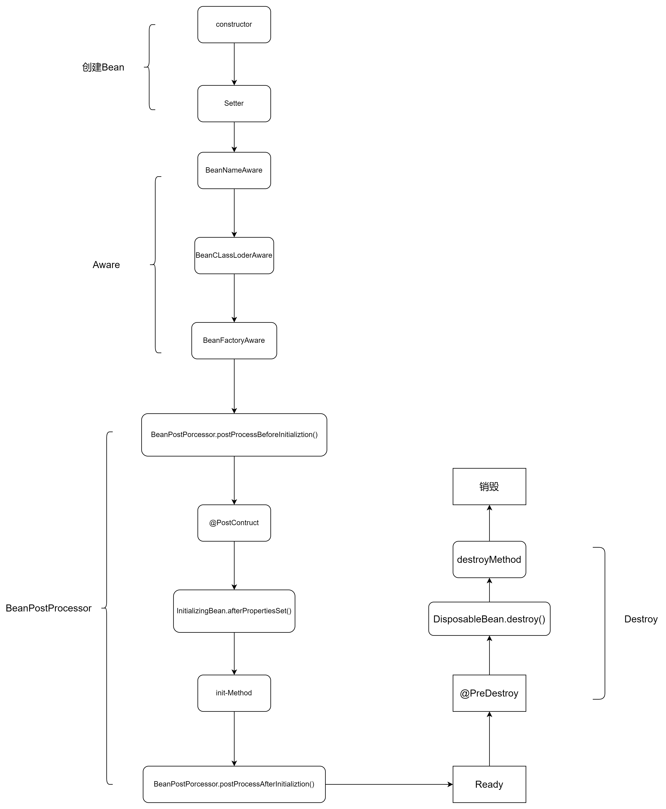

`ApplicationContextAware`、`BeanNameAware` 这些接口，很多人只是"见过"，但说不清它们到底在 Bean 生命周期的哪一步被回调、和 `@PostConstruct` 谁先谁后、为什么构造器里拿不到容器。

这篇从 `initializeBean` 的源码出发，把 Aware 的回调顺序拆开，再看怎么自定义一个 Aware。如果只为面试，可以直接滑到最后的**小结**。

# 总览

**一句话：Aware 是 Spring 在 Bean 初始化阶段回调的一组接口，让 Bean 拿到 `BeanName`、`BeanFactory`、`ApplicationContext` 这些容器能力。**

```text
doCreateBean
  → populateBean（属性填充）
  → initializeBean
      ├─ invokeAwareMethods
      │     BeanNameAware / BeanClassLoaderAware / BeanFactoryAware
      ├─ postProcessBeforeInitialization
      │     ApplicationContextAwareProcessor
      │       EnvironmentAware / ResourceLoaderAware / ApplicationEventPublisherAware /
      │       MessageSourceAware / ApplicationContextAware ...
      │     CommonAnnotationBeanPostProcessor（@PostConstruct）
      ├─ invokeInitMethods
      │     afterPropertiesSet() / init-method
      └─ postProcessAfterInitialization
            AOP 代理在这里生成
```

# 核心概念

## Aware 是什么

Aware 是一组"回调接口"：Bean 实现某个 `Aware` 接口后，Spring 会在初始化阶段把对应的容器能力回传给它。

它不是用来解耦的——恰恰相反，用了 Aware 就和 Spring 绑定了。业务代码只在确实需要访问容器时才用，普通依赖优先走构造器注入。

## 常见 Aware 接口

| 接口 | 回传给你 | 典型用途 |
|---|---|---|
| `BeanNameAware` | `beanName` | 拿到自己的名字 |
| `BeanClassLoaderAware` | `ClassLoader` | 加载类 / 资源 |
| `BeanFactoryAware` | `BeanFactory` | 取 Bean 定义、按需获取其它 Bean |
| `ApplicationContextAware` | `ApplicationContext` | 获取容器、发布事件、拿资源 |
| `EnvironmentAware` | `Environment` | 读配置、profile |
| `ResourceLoaderAware` | `ResourceLoader` | 加载资源文件 |
| `MessageSourceAware` | `MessageSource` | 国际化消息 |
| `ApplicationEventPublisherAware` | `ApplicationEventPublisher` | 发布自定义事件 |



## 回调时机

回调发生在**属性填充之后、初始化方法之前**，具体顺序是：

1. `invokeAwareMethods`：`BeanNameAware`、`BeanClassLoaderAware`、`BeanFactoryAware`；
2. `postProcessBeforeInitialization`：`ApplicationContextAwareProcessor` 处理其余 Aware；
3. 同一个 `postProcessBeforeInitialization` 里，`CommonAnnotationBeanPostProcessor` 处理 `@PostConstruct`；
4. `invokeInitMethods`：`afterPropertiesSet()`、`init-method`；
5. `postProcessAfterInitialization`：AOP 代理。

所以 `ApplicationContextAware` 比 `@PostConstruct` 先执行，`@PostConstruct` 又比 `afterPropertiesSet()` 先执行。

# 源码分析

## initializeBean 里的调用顺序

```java
protected Object initializeBean(String beanName, Object bean, @Nullable RootBeanDefinition mbd) {
    // ① 先回调 BeanNameAware / BeanClassLoaderAware / BeanFactoryAware
    invokeAwareMethods(beanName, bean);

    Object wrappedBean = bean;
    if (mbd == null || !mbd.isSynthetic()) {
        // ② 初始化前：ApplicationContextAwareProcessor、CommonAnnotationBeanPostProcessor 等
        wrappedBean = applyBeanPostProcessorsBeforeInitialization(wrappedBean, beanName);
    }

    // ③ 初始化：afterPropertiesSet() / init-method
    invokeInitMethods(beanName, wrappedBean, mbd);

    if (mbd == null || !mbd.isSynthetic()) {
        // ④ 初始化后：AOP 代理在这里生成
        wrappedBean = applyBeanPostProcessorsAfterInitialization(wrappedBean, beanName);
    }
    return wrappedBean;
}
```

## invokeAwareMethods：只处理三个

```java
private void invokeAwareMethods(String beanName, Object bean) {
    if (bean instanceof Aware) {
        if (bean instanceof BeanNameAware) {
            ((BeanNameAware) bean).setBeanName(beanName);
        }
        if (bean instanceof BeanClassLoaderAware) {
            ClassLoader bcl = getBeanClassLoader();
            if (bcl != null) {
                ((BeanClassLoaderAware) bean).setBeanClassLoader(bcl);
            }
        }
        if (bean instanceof BeanFactoryAware) {
            ((BeanFactoryAware) bean).setBeanFactory(AbstractAutowireCapableBeanFactory.this);
        }
    }
}
```

这三个由 BeanFactory 直接回调，不走 `BeanPostProcessor`。

## ApplicationContextAwareProcessor：处理其余 Aware

`ApplicationContext` 在 `prepareBeanFactory` 时注册了它：

```java
beanFactory.addBeanPostProcessor(new ApplicationContextAwareProcessor(this));
```

它的 `postProcessBeforeInitialization` 会逐个判断并回调：

```java
@Override
@Nullable
public Object postProcessBeforeInitialization(Object bean, String beanName) throws BeansException {
    if (!(bean instanceof EnvironmentAware || bean instanceof EmbeddedValueResolverAware ||
            bean instanceof ResourceLoaderAware || bean instanceof ApplicationEventPublisherAware ||
            bean instanceof MessageSourceAware || bean instanceof ApplicationContextAware)) {
        return bean;
    }

    invokeAwareInterfaces(bean);
    return bean;
}

private void invokeAwareInterfaces(Object bean) {
    if (bean instanceof Aware) {
        if (bean instanceof EnvironmentAware) {
            ((EnvironmentAware) bean).setEnvironment(this.applicationContext.getEnvironment());
        }
        if (bean instanceof EmbeddedValueResolverAware) {
            ((EmbeddedValueResolverAware) bean).setEmbeddedValueResolver(this.embeddedValueResolver);
        }
        if (bean instanceof ResourceLoaderAware) {
            ((ResourceLoaderAware) bean).setResourceLoader(this.applicationContext);
        }
        if (bean instanceof ApplicationEventPublisherAware) {
            ((ApplicationEventPublisherAware) bean).setApplicationEventPublisher(this.applicationContext);
        }
        if (bean instanceof MessageSourceAware) {
            ((MessageSourceAware) bean).setMessageSource(this.applicationContext);
        }
        if (bean instanceof ApplicationContextAware) {
            ((ApplicationContextAware) bean).setApplicationContext(this.applicationContext);
        }
    }
}
```

因为它在 `prepareBeanFactory` 阶段就被加进 `beanPostProcessors`，所以会先于后来注册的 `CommonAnnotationBeanPostProcessor`（`@PostConstruct`）执行。

## 自定义 Aware

Aware 本身就是扩展机制：自定义一个接口继承 `Aware`，再用 `BeanPostProcessor` 回调它。

```java
public interface TenantAware extends Aware {
    void setTenantId(String tenantId);
}

@Component
public class TenantAwareProcessor implements BeanPostProcessor {
    @Override
    public Object postProcessBeforeInitialization(Object bean, String beanName) {
        if (bean instanceof TenantAware) {
            ((TenantAware) bean).setTenantId(TenantContext.getTenantId());
        }
        return bean;
    }
}
```

Spring 不会自动识别自定义 Aware，必须自己注册这个 `BeanPostProcessor`。

# 实战与常见坑

## 场景：在初始化方法里安全使用容器

`ApplicationContextAware` 比 `@PostConstruct` 先执行，所以在 `@PostConstruct` 里可以放心使用回传的 `ApplicationContext`：

```java
@Service
public class ReportService implements ApplicationContextAware {

    private ApplicationContext applicationContext;

    @Override
    public void setApplicationContext(ApplicationContext applicationContext) {
        this.applicationContext = applicationContext;
    }

    @PostConstruct
    public void init() {
        // 这里 applicationContext 已经注入好了
        applicationContext.getBean(ReportProperties.class);
    }
}
```

反过来，在**构造器**里用 `applicationContext` 一定是 `null`——Aware 回调发生在实例化之后。

## 常见坑

1. **在构造器里用 Aware 回传的对象**：构造器执行时 `invokeAwareMethods` 还没跑，字段是 `null`。
2. **业务代码滥用 Aware**：为了拿一个依赖而实现 `ApplicationContextAware`，会让代码和 Spring 强耦合；优先构造器注入。
3. **在 Aware 回调里做重活**：它发生在容器启动阶段，耗时逻辑会拖慢启动，甚至引发循环初始化。
4. **自定义 Aware 忘了注册 `BeanPostProcessor`**：Spring 不会自动识别，回调永远不执行。
5. **`EnvironmentAware` 和 `@Value` 分不清**：简单配置用 `@Value` / `@ConfigurationProperties`；需要动态读取环境、profile 时再用 `EnvironmentAware`。
6. **循环依赖时假设 Aware 已回调**：提前暴露给对方的 Bean 可能还没执行 `initializeBean`，Aware 字段此时还是 `null`。

# 小结

我一向不太喜欢写总结，因为该说的正文里都说了。不过考虑到很多读者是冲着面试来的，还是列成清单：

1. **Aware 是什么？** 一组回调接口，让 Bean 拿到容器能力（BeanName、BeanFactory、ApplicationContext 等）。
2. **回调时机？** 属性填充之后、初始化方法之前。
3. **分几拨触发？** `BeanNameAware` / `BeanClassLoaderAware` / `BeanFactoryAware` 由 `invokeAwareMethods` 直接回调；其余由 `ApplicationContextAwareProcessor` 在初始化前回调。
4. **和 `@PostConstruct` 谁先？** `ApplicationContextAware` 先，`@PostConstruct` 后，然后再是 `afterPropertiesSet()` / `init-method`。
5. **自定义 Aware 怎么做？** 接口继承 `Aware`，再写一个 `BeanPostProcessor` 回调它。
6. **该不该用？** 只在确实需要访问容器时用，否则优先构造器注入。

# 参考

- [Spring Framework 官方文档：Aware Interfaces](https://docs.spring.io/spring-framework/reference/core/beans/factory-nature.html#beans-factory-aware)
- Spring 5.x 源码：`Aware`、`ApplicationContextAwareProcessor`、`AbstractAutowireCapableBeanFactory.invokeAwareMethods`
- [Spring生命周期.md](Spring生命周期.md)、[基本概念.md](基本概念.md)
