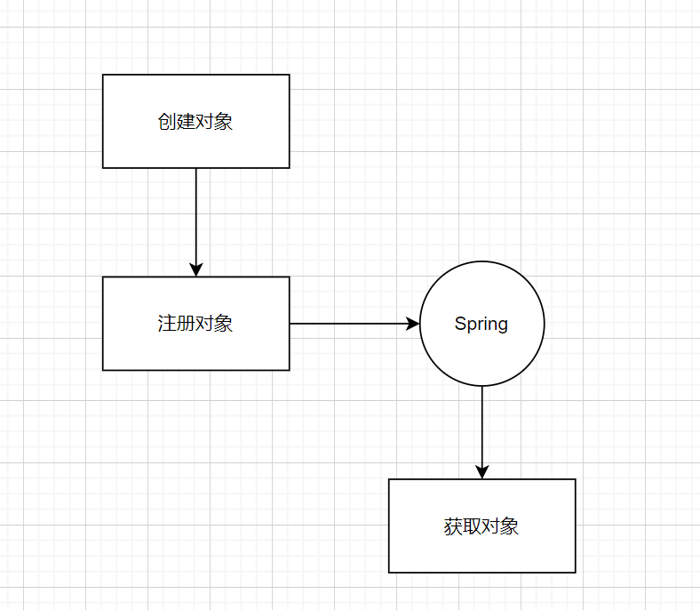

Spring IOC（Inversion of Control，控制反转）是 Spring 的根基。它想说的事其实很简单：**对象的创建和依赖关系的维护，不要你自己干，交给容器**。你只声明"我需要什么"，容器负责把东西造好、接好。

这篇讲清楚三件事：为什么要 IOC、`BeanDefinition` 是什么、一个 Bean 是怎么被造出来并放进容器的。

> 代理不属于 IOC 的范畴——JDK/CGLIB 动态代理是 AOP 的机制，集中在 [SpringAop代理.md](SpringAop代理.md)，本文不再展开。

# 从一个反例说起

假设是一个 MVC 架构，controller 调 service，service 调 dao。最简单（也最糟糕）的写法是到处 `new`：

```java
public class UserController {
    public void login() {
        UserService userService = new UserService();   // 每次用都 new
        userService.login();
    }
}
public class UserService {
    public void login() {
        UserDao userDao = new UserDao();
        userDao.login();
    }
}
```

问题很直接：每次用都 `new` 一个新对象，对象数量暴涨，GC 频率和压力都会明显上升。

有人说，那用缓存/单例不就行了？**不够**。设想一个新需求：统计每个接口、每个 dao 调用的耗时。自己写就会变成这样：

```java
public class UserController {
    public void login() {
        long start = System.currentTimeMillis();
        UserService userService = new UserService();
        userService.login();
        long end = System.currentTimeMillis();
        System.out.println("time is " + (end - start));
    }
}
```

每个接口、每层都要硬编码这些横切逻辑，代码冗余、难维护。**这些"和业务无关、却到处都要"的逻辑，正是 IOC/AOP 要解决的**——把对象的创建、依赖、增强都提到容器层统一处理。

# 总览

一句话概括 IOC 的用法：**一次声明，多次使用**（Bean 默认单例）。

- 你通过注解或配置告诉容器：需要哪些对象、它们之间怎么依赖；
- 容器在运行时把它们造好、接好，需要时按类型/名字取出来；
- 业务代码只依赖接口，不再关心实现从哪来。

随着 Spring 的发展，XML 声明 Bean 的方式基本成了旧时代的写法。微服务时代 SpringBoot 提倡"约定大于配置"，主流改用注解（`@Autowired`、`@Resource` 等）。



# BeanDefinition：Bean 的"图纸"

Spring 不直接"new 对象"，而是先把每个 Bean 解析成一份**定义**——`BeanDefinition`。类型、作用域、依赖、属性值、初始化/销毁方法，都记在这份定义里；容器再照着它创建、管理、销毁 Bean。

```java
/**
 * BeanDefinition 描述了一个 bean 实例的属性值、构造参数等信息。
 * 它是一个最小接口，主要目的是允许 BeanFactoryPostProcessor 查看和修改这些元数据。
 */
public interface BeanDefinition extends AttributeAccessor, BeanMetadataElement {
    String SCOPE_SINGLETON = ConfigurableBeanFactory.SCOPE_SINGLETON;
    String SCOPE_PROTOTYPE = ConfigurableBeanFactory.SCOPE_PROTOTYPE;

    String getScope();                                   // 作用域
    void setDependsOn(@Nullable String... dependsOn);    // 依赖关系
    ConstructorArgumentValues getConstructorArgumentValues();
    boolean isAutowireCandidate();                       // 是否参与自动装配
}
```

`BeanDefinition` 的细节和相关的 `BeanDefinitionReader` / `BeanFactory`，见 [基本概念.md](基本概念.md)。

# Bean 是怎么被造出来的

## 三种实例化方式

Bean 的**实例化**主要有三种：

1. **无参构造**（默认）：反射调用无参构造方法；
2. **工厂方法**（`factoryMethod`）：调用一个工厂方法拿到对象；
3. **`Supplier`**：调用 `Supplier.get()` 得到对象。

此外还可以通过 **`FactoryBean`** 这类扩展点返回对象（`getObject()`），MyBatis 的 Mapper 注册就是典型例子。

> 再次强调：**JDK 动态代理 / CGLIB 不是"创建 Bean 的方式"**，它们是 AOP 生成代理对象的手段，通常发生在 Bean **初始化之后**（`postProcessAfterInitialization`）。详见 [SpringAop代理.md](SpringAop代理.md)。

## 属性填充

代理对象（或原始对象）创建出来后，属性还没填。填充发生在 `AbstractAutowireCapableBeanFactory` 的 `populateBean`（经由 `createBean` → `doCreateBean`）里：

```java
// populateBean 内部最终会调用 applyPropertyValues
try {
    bw.setPropertyValues(new MutablePropertyValues(deepCopy));
}
catch (BeansException ex) {
    // ...
}
```

属性注入的细节（`@Autowired` 怎么找、怎么塞）见 [Spring依赖注入.md](Spring依赖注入.md)。

## 注册到 Spring 容器

Bean 建好、属性填好后，要把它的定义注册进容器。以 XML 为例（注解版由 `AnnotatedBeanDefinitionReader` 完成）：

```java
// DefaultBeanDefinitionDocumentReader：把 <bean> 解析成 BeanDefinition 并注册
protected void processBeanDefinition(Element ele, BeanDefinitionParserDelegate delegate) {
    // 将 BeanDefinition 注册进容器
    BeanDefinitionReaderUtils.registerBeanDefinition(bdHolder, getReaderContext().getRegistry());
    // 默认空实现，依赖 Spring 事件机制——详见 事件机制（待补）
    getReaderContext().fireComponentRegistered(new BeanComponentDefinition(bdHolder));
}
```

# 扩展点：怎么定制 Bean 的生命周期

IOC 的价值之一是"解耦"，那就要知道 Bean 的生命周期，才知道在哪儿插手。几个核心扩展点（完整链路见 [Spring生命周期.md](Spring生命周期.md)）：

| 扩展点 | 作用时机 | 做什么 |
|---|---|---|
| `BeanFactoryPostProcessor` | Bean 实例化**之前** | 修改 BeanDefinition（图纸） |
| `BeanPostProcessor` | Bean **初始化前后** | 修改实例；AOP 代理在此生成 |
| `InitializingBean` | **初始化**时 | `afterPropertiesSet()` 自定义初始化 |
| `DisposableBean` | **销毁**时 | `destroy()` 释放资源 |

```java
// 在 Bean 实例化之前修改 BeanDefinition
@FunctionalInterface
public interface BeanFactoryPostProcessor {
    void postProcessBeanFactory(ConfigurableListableBeanFactory beanFactory) throws BeansException;
}

// 在 Bean 初始化前/后自定义处理
public interface BeanPostProcessor {
    @Nullable default Object postProcessBeforeInitialization(Object bean, String beanName) { return bean; }
    @Nullable default Object postProcessAfterInitialization(Object bean, String beanName) { return bean; }
}
```

`InitializingBean` 的调用在 `AbstractAutowireCapableBeanFactory.invokeInitMethods`：

```java
protected void invokeInitMethods(String beanName, Object bean, @Nullable RootBeanDefinition mbd) throws Throwable {
    boolean isInitializingBean = (bean instanceof InitializingBean);
    if (isInitializingBean && (mbd == null || !mbd.isExternallyManagedInitMethod("afterPropertiesSet"))) {
        // ① 如果实现了 InitializingBean，先调 afterPropertiesSet()
        ((InitializingBean) bean).afterPropertiesSet();
    }
    if (mbd != null && bean.getClass() != NullBean.class) {
        String initMethodName = mbd.getInitMethodName();
        // ② 再调 BeanDefinition 里指定的 init-method
        if (StringUtils.hasLength(initMethodName) &&
                !(isInitializingBean && "afterPropertiesSet".equals(initMethodName)) &&
                !mbd.isExternallyManagedInitMethod(initMethodName)) {
            invokeCustomInitMethod(beanName, bean, mbd);
        }
    }
}
```

> IOC 两个值得重点投入的方向：一是 **Bean 的生命周期与自定义扩展**（比如集成 MyBatis 组件）；二是**事件机制**（`ApplicationListener`），理解了它，就明白 Spring 和 Nacos、Dubbo 这些中间件是怎么互相通信的。

# 小结

1. **IOC 解决什么？** 把对象的创建与依赖维护从业务代码里挪进容器，降低耦合、方便替换与测试。
2. **为什么要 BeanDefinition？** 容器先把 Bean 解析成"图纸"，再照图施工，这样才有 `BeanFactoryPostProcessor` 等修改定义的机会。
3. **Bean 有哪几种实例化方式？** 无参构造、工厂方法（`factoryMethod`）、`Supplier`；`FactoryBean` 是另一种扩展。
4. **动态代理算创建 Bean 的方式吗？** 不算，它是 AOP 生成代理的手段，发生在初始化之后。
5. **几个扩展点的时机？** `BeanFactoryPostProcessor`（实例化前，改定义）、`BeanPostProcessor`（初始化前后，改实例）、`InitializingBean`（初始化）、`DisposableBean`（销毁）。

# 参考

- Spring 5.x 源码：`BeanDefinition`、`AbstractAutowireCapableBeanFactory`、`DefaultBeanDefinitionDocumentReader`
- [基本概念.md](基本概念.md)、[Spring生命周期.md](Spring生命周期.md)、[SpringAop代理.md](SpringAop代理.md)
