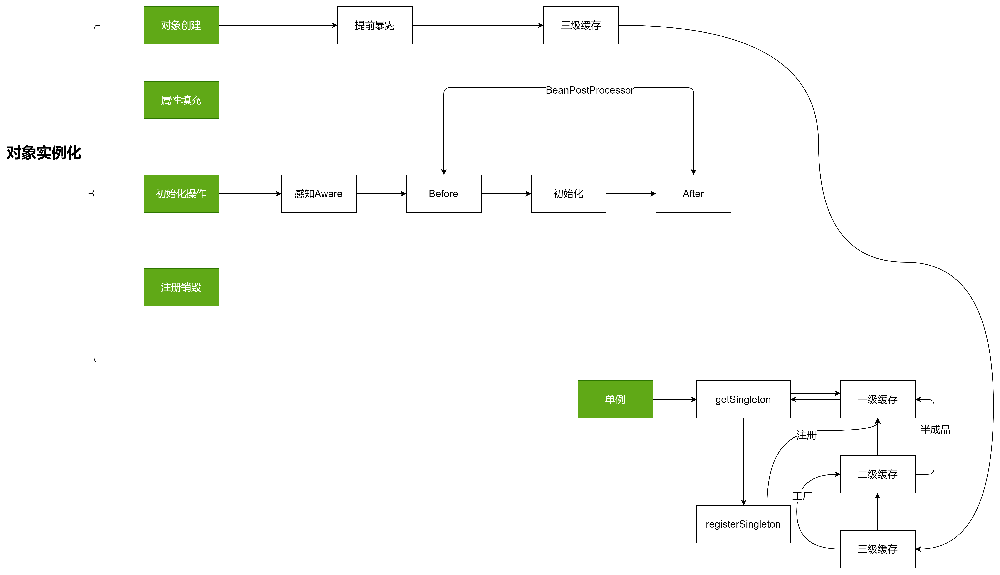
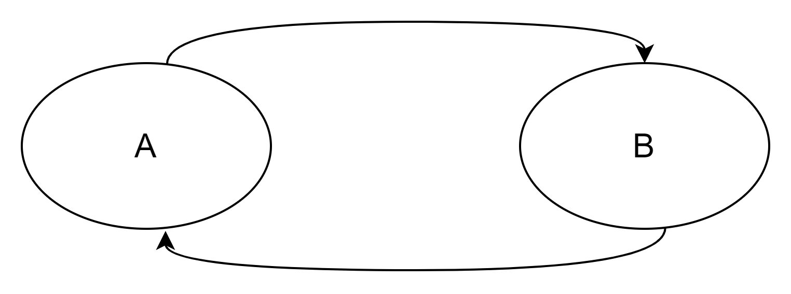
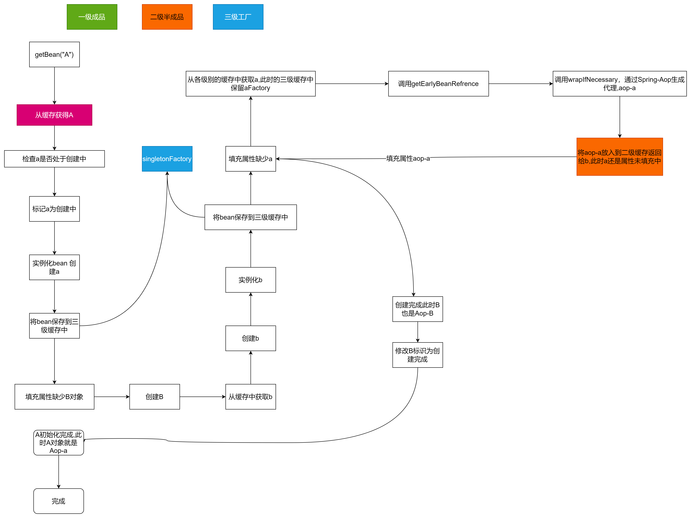

# 什么是循环依赖

简单说，就是对象之间的依赖关系形成了一个环：A 的字段里需要 B，B 的字段里又需要 A。画出来是 `A → B → A`；也可能是 `A → B → C → A` 这种间接的环。

用代码表示：

```java
class A {
    B b;
}

class B {
    A a;
}
```

# 为什么会出问题

容器创建对象是一个接一个来的：要创建 A，得先把 A 依赖的 B 创建好；要创建 B，又得先把 B 依赖的 A 创建好。于是"创建 A"的过程里又在等 A，形成永远等不到的死循环，最后只能报错或者无限递归。

根源不是"对象之间不能互相依赖"，而是**创建顺序**：如果 A、B 都能先创建出来、再互相设置引用，这个环其实可以解开。Spring 的三级缓存做的就是这件事——让 A 在还没完全创建好时，就能先被 B 拿到。

这篇不背结论，直接从 `doGetBean` 的源码看：三级缓存分别在哪一步写入、哪一步读取，为什么两级不够，以及构造器和 prototype 为什么解不了。

# 先说结论

- **字段注入 / setter 注入**的循环依赖：能解决；
- **构造器注入**的循环依赖：解决不了；
- **prototype 作用域**的循环依赖：解决不了。

还有一个容易被忽略的前提：**三级缓存不是"多级缓存"本身起了作用，真正要解决的是"AOP 代理什么时候生成"**。下面用源码把这件事讲清楚。

# 只用一个 Map 够不够？

先别急着上三级。写一个最简容器：只有一个 `Map`，对象实例化后先放进去，再填属性：

```java
public class Singleton {
    private static final Map<String, Object> singleMap = new ConcurrentHashMap<>();

    public static void main(String[] args) throws Exception {
        System.out.println(getBean(B.class).getA());
        System.out.println(getBean(A.class).getB());
    }

    private static <T> T getBean(Class<T> beanClass) throws Exception {
        String beanName = beanClass.getSimpleName().toLowerCase();
        if (singleMap.containsKey(beanName)) {
            return (T) singleMap.get(beanName);
        }
        Object obj = beanClass.newInstance();
        singleMap.put(beanName, obj);             // ① 先入缓存：半成品也能被取到
        for (Field field : obj.getClass().getDeclaredFields()) {
            field.setAccessible(true);
            Class<?> fieldClass = field.getType();
            String fieldBeanName = fieldClass.getSimpleName().toLowerCase();
            field.set(obj, singleMap.containsKey(fieldBeanName)
                    ? singleMap.get(fieldBeanName)              // ② 已在缓存里，直接取（打破循环的关键）
                    : getBean(fieldClass));
        }
        return (T) obj;
    }
}
```

跑出来 A 和 B 能互相持有，**没报错**：

```text
com.xiao.A@4f3f5b24
com.xiao.B@15aeb7ab
```

所以"一级缓存解决不了循环依赖"这个说法**并不准确**：对普通字段注入，一个 Map 就够——**实例化后立刻放进 Map，再填属性**，对方来取时就能拿到这个半成品（对象已经 new 出来，但属性还没填完）。

那 Spring 为什么还要三级？因为它还要处理 AOP 代理，而代理不该在这个时间点生成。下面开始看源码。

# Spring 的调用链

## 第一步：doGetBean 先查缓存

`getBean` 最终会走到 `AbstractBeanFactory.doGetBean`。它先尝试从缓存拿，拿不到才创建：

```java
protected <T> T doGetBean(String name, @Nullable Class<T> requiredType,
        @Nullable Object[] args, boolean typeCheckOnly) throws BeansException {

    String beanName = transformedBeanName(name);
    Object bean;

    // ① 先查缓存：一级 → 二级 → 三级（三级会执行 ObjectFactory）
    Object sharedInstance = getSingleton(beanName);
    if (sharedInstance != null && args == null) {
        // 命中：可能是完整 Bean，也可能是提前暴露的半成品 / 代理
        bean = getObjectForBeanInstance(sharedInstance, name, beanName, null);
    } else {
        // ② 没命中，进入创建流程
        // ...
        if (mbd.isSingleton()) {
            sharedInstance = getSingleton(beanName, () -> {
                try {
                    return createBean(beanName, mbd, args);   // 最终到 doCreateBean
                } catch (BeansException ex) {
                    destroySingleton(beanName);
                    throw ex;
                }
            });
            bean = getObjectForBeanInstance(sharedInstance, name, beanName, mbd);
        }
        // ...
    }
    return (T) bean;
}
```

关键就是两个重载：`getSingleton(beanName)` 负责**读**，`getSingleton(beanName, factory)` 负责**创建并登记**。

## 第二步：getSingleton 的三级查找

```java
protected Object getSingleton(String beanName, boolean allowEarlyReference) {
    // 一级：完整 Bean
    Object singletonObject = this.singletonObjects.get(beanName);

    // 一级没有，且这个 Bean 正在创建中，才去查"提前暴露"的缓存
    if (singletonObject == null && isSingletonCurrentlyInCreation(beanName)) {
        // 二级：已经提前暴露出来的半成品 / 代理
        singletonObject = this.earlySingletonObjects.get(beanName);

        if (singletonObject == null && allowEarlyReference) {
            synchronized (this.singletonObjects) {
                // 双重检查：锁内再看一次，防止并发下重复创建
                singletonObject = this.singletonObjects.get(beanName);
                if (singletonObject == null) {
                    singletonObject = this.earlySingletonObjects.get(beanName);
                    if (singletonObject == null) {
                        // 三级：拿到 ObjectFactory，执行它才有对象
                        ObjectFactory<?> singletonFactory = this.singletonFactories.get(beanName);
                        if (singletonFactory != null) {
                            singletonObject = singletonFactory.getObject();
                            // 升级到二级，并从三级移除
                            this.earlySingletonObjects.put(beanName, singletonObject);
                            this.singletonFactories.remove(beanName);
                        }
                    }
                }
            }
        }
    }
    return singletonObject;
}
```

这段就是三级缓存的完整逻辑：

- **一级 `singletonObjects`**：完整 Bean，正常 `getBean` 都从这里拿；
- **二级 `earlySingletonObjects`**：提前暴露的半成品（或代理），只有循环依赖时才会出现；
- **三级 `singletonFactories`**：`ObjectFactory`，还没决定要不要生成代理，所以先放"怎么造"的 Lambda；
- **`isSingletonCurrentlyInCreation(beanName)`**：只有正在创建中的 Bean 才允许走"提前暴露"，否则二级/三级根本不会查。

## 第三步：创建并登记

`getSingleton(beanName, factory)` 负责"创建 + 标记 + 登记"：

```java
public Object getSingleton(String beanName, ObjectFactory<?> singletonFactory) {
    synchronized (this.singletonObjects) {
        Object singletonObject = this.singletonObjects.get(beanName);
        if (singletonObject == null) {
            // ① 标记"正在创建"：加入 singletonsCurrentlyInCreation
            //    这样别人来 getSingleton 时，才知道可以走"提前暴露"
            beforeSingletonCreation(beanName);

            boolean newSingleton = false;
            try {
                // ② 真正创建：最终调到 createBean → doCreateBean
                singletonObject = singletonFactory.getObject();
                newSingleton = true;
            } catch (IllegalStateException ex) {
                // 循环依赖检测抛出的异常，原样往上抛
                throw ex;
            } finally {
                // ③ 移除"正在创建"标记
                afterSingletonCreation(beanName);
            }

            if (newSingleton) {
                // ④ 创建完成：放入一级缓存，清理二、三级
                addSingleton(beanName, singletonObject);
            }
        }
        return singletonObject;
    }
}
```

`addSingleton` 的作用是把 Bean 放进一级缓存，并清掉二、三级缓存：

```java
protected void addSingleton(String beanName, Object singletonObject) {
    synchronized (this.singletonObjects) {
        this.singletonObjects.put(beanName, singletonObject);
        this.singletonFactories.remove(beanName);     // 三级不再需要
        this.earlySingletonObjects.remove(beanName);  // 二级不再需要
        this.registeredSingletons.add(beanName);
    }
}
```

## 第四步：doCreateBean 把 ObjectFactory 放进三级缓存

`doCreateBean` 在**实例化之后、属性填充之前**，会判断要不要提前暴露：

```java
boolean earlySingletonExposure = (mbd.isSingleton() && this.allowCircularReferences &&
        isSingletonCurrentlyInCreation(beanName));
if (earlySingletonExposure) {
    // 放进三级缓存的不是对象，而是"怎么拿到对象"的 Lambda
    addSingletonFactory(beanName, () -> getEarlyBeanReference(beanName, mbd, bean));
}
```

为什么必须在属性填充之前？因为 A 填属性时可能要用 B，而 B 又要用 A；此时 A 还没填完，只能先把"怎么拿到 A"的工厂放进去，等 B 来取。

`getEarlyBeanReference` 负责决定"现在要不要生成代理"：

```java
protected Object getEarlyBeanReference(String beanName, RootBeanDefinition mbd, Object bean) {
    Object exposedObject = bean;
    if (!mbd.isSynthetic() && hasInstantiationAwareBeanPostProcessors()) {
        for (SmartInstantiationAwareBeanPostProcessor bp : getBeanPostProcessorCache().smartInstantiationAware) {
            exposedObject = bp.getEarlyBeanReference(exposedObject, beanName);
        }
    }
    return exposedObject;
}
```

`AbstractAutoProxyCreator` 的实现会在这里提前生成代理，并记录到 `earlyProxyReferences`：

```java
@Override
public Object getEarlyBeanReference(Object bean, String beanName) {
    Object cacheKey = getCacheKey(bean.getClass(), beanName);
    this.earlyProxyReferences.put(cacheKey, bean);   // 记下来，避免后面重复代理
    return wrapIfNecessary(bean, beanName, cacheKey); // 需要 AOP 就返回代理，否则返回原对象
}
```

# 把 A ↔ B 走一遍

假设 A、B 都是单例，字段注入，且 A 需要被 AOP 增强：

```text
getBean(A)
  → getSingleton("a")：一级、二级、三级都没有
  → getSingleton("a", factory)
      → beforeSingletonCreation("a")        // a 标记为"正在创建"
      → createBean("a") → doCreateBean("a")
          → createBeanInstance：new A()
          → addSingletonFactory("a", lambda)  // 三级缓存有 a 了
          → populateBean("a")：发现要注入 b
              → getBean(B)
                  → getSingleton("b")：没有
                  → getSingleton("b", factory)
                      → beforeSingletonCreation("b")
                      → createBean("b") → doCreateBean("b")
                          → new B()
                          → addSingletonFactory("b", lambda)
                          → populateBean("b")：发现要注入 a
                              → getBean(A)
                                  → getSingleton("a")
                                     一级没有；isSingletonCurrentlyInCreation("a") = true
                                     二级没有；三级有 a 的 lambda
                                     → 执行 lambda → getEarlyBeanReference("a")
                                     → 需要 AOP：提前生成 a 的代理
                                     → 代理放入二级，三级移除
                                     → 返回 a 的代理
                          → B 拿到 a 的代理
                      → addSingleton("b")    // b 进一级
              → A 拿到 b
          → populateBean("a") 完成
          → initializeBean("a")：此时会看到 earlyProxyReferences 里已有 a，
                                 不再重复生成代理
          → addSingleton("a")       // a（代理）进一级
```

关键点：**B 拿到的是 a 的代理，不是原始对象**。这就是三级缓存里放 `ObjectFactory` 而不是直接放对象的原因——代理是在"第一次有人来提前取"的那一刻才生成的。

# 为什么两级不够

如果只有两级（一级放完整 Bean，二级放提前暴露的对象），二级里只能直接放**原始对象**：

- A 实例化后，把原始 A 放进二级；
- B 来取，拿到原始 A；
- A 后续在 `postProcessAfterInitialization` 里生成了代理，但 B 手里的引用已经指向原始 A；
- B 调用 A 时走的是原始对象，**事务、日志这些增强全部失效**。

三级缓存把"放对象"换成了"放工厂"：只有真的发生循环依赖、有人来取时，才执行 `getEarlyBeanReference`，决定"现在要不要提前生成代理"。如果整个容器里没有循环依赖，这个 Lambda 根本不会执行，也就不会提前生成代理。

> 一句话：**二级缓存解决"有没有对象"，三级缓存解决"现在要不要生成代理"。**

# 为什么构造器和 prototype 解不了

## 构造器注入

`doCreateBean` 的顺序是：**先 `createBeanInstance`（会解析构造参数），后 `addSingletonFactory`**。

也就是说，A 在解析构造参数时，还没执行到"把 ObjectFactory 放进三级缓存"这一步。此时 B 的构造器又来要 A，`getSingleton("a")` 拿不到任何东西，只能再去创建 A；而 A 已经被标记为"正在创建"，`beforeSingletonCreation` 会直接抛出 `BeanCurrentlyInCreationException`。

根因：**对象还没实例化出来，没有东西可以提前暴露。**

## prototype

prototype 的 `getBean` 走的是另一条分支：**每次调用都新建，不查单例缓存，也不进三级缓存**。

Spring 对 prototype 只做"正在创建"的标记（`beforePrototypeCreation` / `afterPrototypeCreation`），发现循环就直接抛 `BeanCurrentlyInCreationException`。没有缓存可以提前暴露，自然解不了。

# 三级缓存总结

| 缓存 | 放什么 | 写入时机 | 读取时机 |
|---|---|---|---|
| `singletonObjects`（一级） | 完整 Bean（可能是代理） | `addSingleton`，创建完成后 | 每次 `getBean` 先查 |
| `earlySingletonObjects`（二级） | 提前暴露的半成品 / 代理 | 三级 Lambda 执行后升级进来 | 一级没有且正在创建时 |
| `singletonFactories`（三级） | `ObjectFactory`（Lambda） | `doCreateBean` 实例化后、填充属性前 | 二级也没有时才执行 |
| `earlyProxyReferences` | 已提前做过 AOP 的原始对象 | `getEarlyBeanReference` | `postProcessAfterInitialization` 时检查，避免重复代理 |







# 实战提醒

1. **Spring Boot 2.6+ 默认禁止循环依赖**：`spring.main.allow-circular-references` 默认为 `false`，循环依赖会直接启动失败。需要兼容老代码时可以打开，但更好的做法是重构依赖。
2. **`@Lazy` 可以打破循环依赖**：在其中一个依赖上加 `@Lazy`，注入的是代理，第一次真正调用时才解析，构造器循环依赖也能绕过。
3. **循环依赖本身是设计问题**：三级缓存是兜底，不是鼓励 A、B 互依赖。能通过分层、事件、接口拆分解决的，优先重构。

# 小结

1. **什么是循环依赖？** A 依赖 B、B 又依赖 A，互相等待，没有任何缓存的实现会无限递归。
2. **一级缓存能解决吗？** 对普通字段注入能——实例化后先放进 Map 再填属性即可。
3. **为什么还要三级？** 因为 AOP：要能在对象未初始化完成时暴露引用，又要保证最终暴露的是**代理**，所以需要工厂来延迟决策。
4. **二级为什么不够？** 二级只能放原始对象，提前注入的引用会指向原始对象，导致代理失效。
5. **三级缓存放的是什么？** `ObjectFactory`（`() -> getEarlyBeanReference(...)`），不是代理对象。
6. **代理是什么时候生成的？** 第一次有人来提前取时，执行三级 Lambda 才生成；没有循环依赖就不会提前生成。
7. **构造器 / prototype 为什么不行？** 构造器注入时对象还没实例化、没得暴露；prototype 不进缓存，而解法依赖缓存。

# 参考

- Spring 5.x 源码：`AbstractBeanFactory.doGetBean`、`DefaultSingletonBeanRegistry`、`AbstractAutowireCapableBeanFactory.getEarlyBeanReference`
- [Spring生命周期.md](Spring生命周期.md)、[SpringAop代理.md](SpringAop代理.md)、[Spring依赖注入.md](Spring依赖注入.md)
