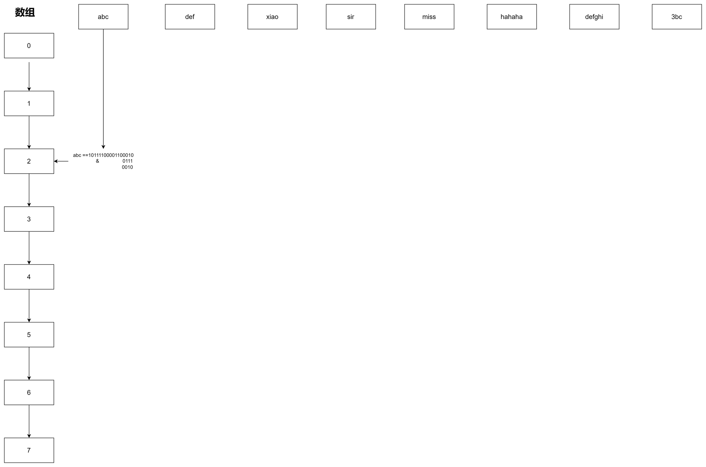

HashMap 大概是面试里被问得最多的集合类。市面上"一篇背完"的八股很多，但光背结论很容易一追问就露馅。这篇换个方式：把 JDK8 的 `hash`、`putVal`、`resize` 几个方法**一行一行看过去**，看完之后那些"为什么是 2 的幂""为什么树化阈值是 8"自然就懂了。

> 本文对着 JDK8 的 `HashMap` 源码看即可。只想冲刺面试的，可以直接翻到最后的**小结**。

# 总览

一句话记住 JDK8 的结构：**数组 + 链表 + 红黑树**。几个关键字段：

| 字段 | 含义 |
|---|---|
| `table` | 哈希桶数组，长度**总是 2 的幂** |
| `size` | 键值对个数 |
| `threshold` | 扩容阈值 = `capacity × loadFactor` |
| `loadFactor` | 负载因子，默认 `0.75` |
| `TREEIFY_THRESHOLD` | 8，链表转红黑树的阈值 |
| `UNTREEIFY_THRESHOLD` | 6，红黑树退化成链表的阈值 |
| `MIN_TREEIFY_CAPACITY` | 64，树化的最小容量 |



# 为什么容量必须是 2 的幂

下标是这样算的：

```java
// 不是 hash % n，而是 hash & (n - 1)
int index = (n - 1) & hash;
```

n 是 2 的幂时，`n - 1` 的低位全是 1，位与就等价于 `hash % n`，但位运算快得多。如果 n 不是 2 的幂，`& (n - 1)` 就不再等价于取模，分布会出错——**这就是容量必须是 2 的幂的根本原因**。

# 扰动函数

光有 `& (n-1)` 还不够：`hashCode` 是 32 位，但取模只用到了低位，**高位全被丢掉**，冲突会变多。于是有了扰动函数：

```java
static final int hash(Object key) {
    int h;
    // key 为 null 时 hash 记为 0，所以 null key 固定落在下标 0
    // 否则：h = hashCode，再让它和自己的高 16 位异或
    return (key == null) ? 0 : (h = key.hashCode()) ^ (h >>> 16);
}
```

`h ^ (h >>> 16)` 把高 16 位混进低 16 位，让高位也参与下标计算，减少冲突。**这也是 HashMap 允许 1 个 null key 的原因**：null 的 hash 直接记 0。

# put 流程

`put` 只是入口，真正的逻辑在 `putVal`（省略了红黑树插件回调等细节）：

```java
public V put(K key, V value) {
    return putVal(hash(key), key, value, false, true);
}

final V putVal(int hash, K key, V value, boolean onlyIfAbsent, boolean evict) {
    Node<K,V>[] tab; Node<K,V> p; int n, i;

    // 1. 数组还没初始化，先初始化（默认 16）
    if ((tab = table) == null || (n = tab.length) == 0)
        n = (tab = resize()).length;

    // 2. 桶为空，直接放一个新节点
    if ((p = tab[i = (n - 1) & hash]) == null)
        tab[i] = newNode(hash, key, value, null);
    else {
        Node<K,V> e; K k;
        // 3. 桶头就是同一个 key，记下它，稍后覆盖
        if (p.hash == hash &&
            ((k = p.key) == key || (key != null && key.equals(k))))
            e = p;
        // 4. 桶里是红黑树，走树的插入
        else if (p instanceof TreeNode)
            e = ((TreeNode<K,V>)p).putTreeVal(this, tab, hash, key, value);
        else {
            // 5. 桶里是链表，尾插
            for (int binCount = 0; ; ++binCount) {
                if ((e = p.next) == null) {
                    p.next = newNode(hash, key, value, null);
                    // 链表长度达到 8（binCount 从 0 起，所以是 >= 7），尝试树化
                    if (binCount >= TREEIFY_THRESHOLD - 1)
                        treeifyBin(tab, hash);
                    break;
                }
                // 链表途中就命中 key，停止
                if (e.hash == hash &&
                    ((k = e.key) == key || (key != null && key.equals(k))))
                    break;
                p = e;
            }
        }
        // 6. key 已存在，覆盖 value 并返回旧值
        if (e != null) {
            V oldValue = e.value;
            if (!onlyIfAbsent || oldValue == null)
                e.value = value;
            afterNodeAccess(e);
            return oldValue;
        }
    }
    ++modCount;
    // 7. size 超过阈值就扩容
    if (++size > threshold)
        resize();
    afterNodeInsertion(evict);
    return null;
}
```

一句话记住：**算 hash 和下标 → 桶空直接放 → key 相同则覆盖 → 是树走树插入 → 否则尾插链表 → 链表到 8 尝试树化 → `++size > threshold` 时扩容。**

> 注意 key 的比较用的是 `p.hash == hash && (k == key || key.equals(k))`：先比 hash 再比 `==` 再比 `equals`，逐级过滤，尽量少调 `equals`。

# 扩容

扩容到两倍后，多出来的那一位正好是 `oldCap`，所以**不用重新算 hash**，只需看 `hash & oldCap`。这是 JDK8 相对 JDK7 最大的优化。核心迁移循环：

```java
final Node<K,V>[] resize() {
    // ... 前面是算新容量 newCap = oldCap << 1、新阈值 newThr = oldThr << 1（省略）

    // 逐个桶迁移
    for (int j = 0; j < oldCap; ++j) {
        Node<K,V> e;
        if ((e = oldTab[j]) != null) {
            oldTab[j] = null;
            if (e.next == null)                       // 桶里只有一个节点，直接重算下标
                newTab[e.hash & (newCap - 1)] = e;
            else if (e instanceof TreeNode)
                ((TreeNode<K,V>)e).split(this, newTab, j, oldCap);   // 红黑树拆分
            else { // 链表：拆成低位链和高位链
                Node<K,V> loHead = null, loTail = null;
                Node<K,V> hiHead = null, hiTail = null;
                Node<K,V> next;
                do {
                    next = e.next;
                    if ((e.hash & oldCap) == 0) {     // 多出来那一位是 0 → 低位链
                        if (loTail == null) loHead = e;
                        else loTail.next = e;
                        loTail = e;
                    } else {                          // 是 1 → 高位链
                        if (hiTail == null) hiHead = e;
                        else hiTail.next = e;
                        hiTail = e;
                    }
                } while ((e = next) != null);
                if (loTail != null) {                 // 低位链留在原下标
                    loTail.next = null;
                    newTab[j] = loHead;
                }
                if (hiTail != null) {                 // 高位链搬到 原下标 + oldCap
                    hiTail.next = null;
                    newTab[j + oldCap] = hiHead;
                }
            }
        }
    }
    return newTab;
}
```

对照 JDK7 的差别就清楚了：**JDK7 是重新计算 hash（rehash）+ 头插；JDK8 是高低位拆分 + 尾插**，既省了重算，又避免了头插在并发下的成环问题。

# 树化与退化

```java
final void treeifyBin(Node<K,V>[] tab, int hash) {
    int n, index; Node<K,V> e;
    // 容量不到 64 时，先扩容而不是树化 —— 很可能只是桶太少
    if (tab == null || (n = tab.length) < MIN_TREEIFY_CAPACITY)
        resize();
    else if ((e = tab[index = (n - 1) & hash]) != null) {
        // ... 把链表转成红黑树（省略）
    }
}
```

- 链表长度 ≥ 8 **且** `table.length ≥ 64` 才真的转红黑树，否则先扩容；
- 节点数 ≤ 6 时退化成链表——6 和 8 之间留了缓冲，避免在边界反复转换。

为什么阈值是 8？在负载因子 0.75 下，一个桶里放 8 个节点的概率约 `6e-8`（泊松分布），已经极低，所以到这个长度基本可以认为冲突异常，值得转树。

# get 流程

```java
final Node<K,V> getNode(int hash, Object key) {
    Node<K,V>[] tab; Node<K,V> first, e; int n; K k;
    if ((tab = table) != null && (n = tab.length) > 0 &&
        (first = tab[(n - 1) & hash]) != null) {
        // 桶头就是目标，直接返回
        if (first.hash == hash &&
            ((k = first.key) == key || (key != null && key.equals(k))))
            return first;
        if ((e = first.next) != null) {
            if (first instanceof TreeNode)
                return ((TreeNode<K,V>)first).getTreeNode(hash, key);   // 树里找
            do {                                                        // 链表里找
                if (e.hash == hash &&
                    ((k = e.key) == key || (key != null && key.equals(k))))
                    return e;
            } while ((e = e.next) != null);
        }
    }
    return null;
}
```

# 为什么线程不安全

- **JDK7**：扩容用**头插**，并发 `transfer` 可能形成环形链表，后续 `get` 就会死循环，还会丢数据；
- **JDK8**：改成**尾插**，不会成环了，但并发 `put` 仍会互相覆盖、丢数据，`size` 也不准。

想要线程安全：`Hashtable`（方法级 `synchronized`，性能差）、`Collections.synchronizedMap`（mutex 加锁）、**`ConcurrentHashMap`（首选）**——JDK8 用 CAS + `synchronized` 锁单个桶。

# 小结

面试冲刺看这一节就够了。

1. **为什么容量是 2 的幂？** 下标用 `(n-1) & hash`，2 的幂时等价于取模但更快；扩容时还能用 `hash & oldCap` 判断留在原位还是移到 `原下标 + oldCap`。
2. **扰动函数干什么？** `h ^ (h >>> 16)` 把高 16 位混进低位，让高位也参与下标计算，减少冲突。
3. **put 流程？** 算 hash 和下标 → 桶空直接放 → key 相同覆盖 → 树节点走树插入 → 否则尾插链表 → 链表到 8 且容量 ≥ 64 树化 → 超阈值扩容。
4. **扩容怎么做？** 容量和阈值都翻倍；JDK8 用高低位拆分（`hash & oldCap`）迁移，不重算 hash；JDK7 是 rehash + 头插。
5. **为什么负载因子 0.75？** 时间与空间的折中：太高冲突多、链表长；太低浪费空间。
6. **树化和退化的阈值？** `TREEIFY_THRESHOLD=8`、`MIN_TREEIFY_CAPACITY=64`、`UNTREEIFY_THRESHOLD=6`。
7. **为什么线程不安全？** JDK7 头插并发扩容会成环死循环；JDK8 尾插不成环，但仍会覆盖、丢数据、`size` 不准。
8. **什么是 fail-fast？** 迭代器内部记录 `modCount`，迭代中结构被修改（put/remove）会抛 `ConcurrentModificationException`；用 `iterator.remove()` 是安全的。
9. **允许 null 吗？** HashMap 允许 **1 个 null key**（hash 记 0，落在下标 0）和**多个 null value**；Hashtable 两者都不允许（源码直接判空抛 `NullPointerException`）。
10. **对 key 有什么要求？** 必须正确重写 `hashCode()` 和 `equals()`（契约：equals 相等则 hashCode 必须相等），且尽量用不可变对象——key 的 hashCode 变了就再也定位不到了。
11. **冲突有哪些解决方式？** 链地址法（HashMap 用它）、开放地址法（线性/二次探测）、再哈希法、公共溢出区。
12. **JDK7 vs JDK8？** 结构：数组+链表 → 数组+链表+红黑树；插入：头插 → 尾插；hash：4 次移位异或 → 一次 `h ^ (h >>> 16)`；扩容：rehash → 高低位拆分；并发：可能成环 → 不成环但会覆盖。

# 参考

- JDK8 `HashMap` 源码
- javadoop - [Java7/8 中的 HashMap 和 ConcurrentHashMap 全解析](https://javadoop.com/post/hashmap)
