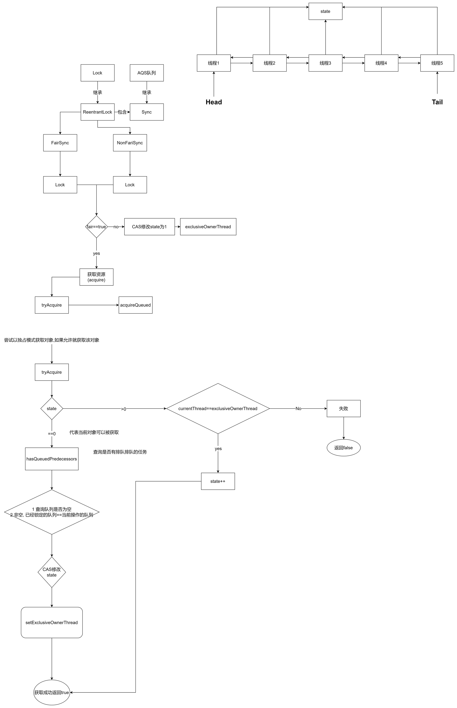
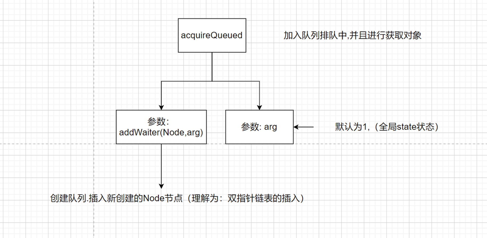
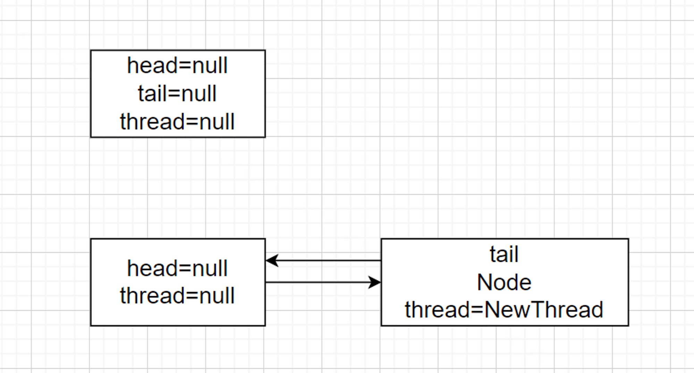
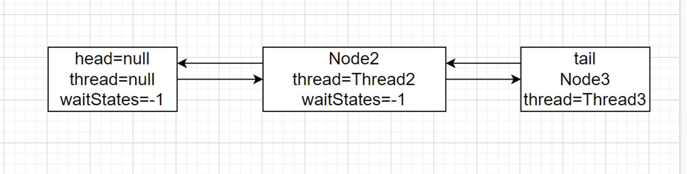

# what

ReentrantLock 是 JUC 下基于 AQS 实现的**可重入互斥锁**，实现了 `Lock` 接口。和 synchronized 相比，它提供了可中断、超时、公平锁、多条件变量等能力，代价是必须手动 `unlock()`。

# 和 synchronized 怎么选

| | synchronized | ReentrantLock |
|---|---|---|
| 层级 | JVM 关键字 | JDK API |
| 释放 | 自动（异常也释放） | 必须 `finally unlock()` |
| 可中断 | 抢锁时不可中断 | `lockInterruptibly()` |
| 超时 / 尝试 | 不支持 | `tryLock()` / `tryLock(timeout)` |
| 公平锁 | 非公平 | 可选公平 |
| 条件变量 | 一个 wait/notify 集合 | 多个 `Condition` |
| 适用 | 一般同步 | 需要超时、中断、多条件时 |

优先用 synchronized；需要上面这些高级能力时再用 ReentrantLock。

# 核心原理（AQS）

## 两个核心状态

- `state`：`volatile int`，0 表示未占用，大于 0 表示重入次数；
- `exclusiveOwnerThread`：当前持有锁的线程（来自 `AbstractOwnableSynchronizer`）；
- 等待队列：CLH 变体的**双向链表**，head 是哨兵节点。

## lock 流程

1. `tryAcquire`：CAS 把 `state` 从 0 改成 1，成功则记录 owner；
2. 如果 owner 是自己，`state + 1`（重入）；
3. 失败则 `addWaiter` 入队；
4. `acquireQueued`：前驱是 head 且 `tryAcquire` 成功，说明轮到自己，把自己设为新 head；
5. 否则 `shouldParkAfterFailedAcquire` → `LockSupport.park` 挂起，等前驱 unpark 后继续循环。



```java
final boolean acquireQueued(final Node node, int arg) {
    boolean failed = true;
    try {
        boolean interrupted = false;
        for (;;) {
            final Node p = node.predecessor();
            if (p == head && tryAcquire(arg)) {   // 轮到自己，且拿到了锁
                setHead(node);
                p.next = null;                    // help GC
                failed = false;
                return interrupted;
            }
            if (shouldParkAfterFailedAcquire(p, node) && parkAndCheckInterrupt())
                interrupted = true;
        }
    } finally {
        if (failed) cancelAcquire(node);
    }
}
```

注意第一分支不是"抢锁失败"，而是"排队后轮到自己、恰好能拿到锁"的快速路径。




`shouldParkAfterFailedAcquire` 的作用：第一次进入时把前驱的 `waitStatus` CAS 成 `Node.SIGNAL` 并返回 false；第二次看到 `ws == SIGNAL` 才返回 true，然后 park。



## unlock 流程

```java
public final boolean release(int arg) {
    if (tryRelease(arg)) {
        Node h = head;
        if (h != null && h.waitStatus != 0)
            unparkSuccessor(h);
        return true;
    }
    return false;
}
```

- `tryRelease`：`state - 1`，减到 0 时把 `exclusiveOwnerThread` 置空；
- `unparkSuccessor`：找到 head 后面第一个未被取消的节点，`LockSupport.unpark` 唤醒它。

## 公平锁 vs 非公平锁

- 非公平：`lock()` 先直接 CAS 抢一次（插队）；`tryAcquire` 时也不看队列；
- 公平：`tryAcquire` 先调 `hasQueuedPredecessors()`，只要前面有人排队就不抢，乖乖排队。

非公平吞吐更高，但可能让排队线程饥饿；公平锁吞吐低一些，胜在顺序。

## 可重入

同一线程重复 `lock()`，`state` 累加；`unlock()` 递减，减到 0 才真正释放并唤醒后继。

# 八股速查

## 1. ReentrantLock 和 AQS 的关系？

ReentrantLock 把同步逻辑委托给内部类 `Sync`（继承 AQS），公平/非公平分别是 `FairSync` / `NonfairSync`，重写 `tryAcquire` / `tryRelease`。

## 2. state 的作用？

表示锁的占用状态和重入次数：0 空闲，大于 0 被占用且数值是重入次数。通过 CAS 修改，保证并发安全。

## 3. 公平锁和非公平锁的区别？

非公平锁允许插队，吞吐高但可能饥饿；公平锁用 `hasQueuedPredecessors()` 检查队列，保证先来先得。

## 4. 可重入怎么实现的？

`state` 计数：同一线程再次加锁时 `state + 1`，解锁时 `- 1`，只有减到 0 才释放锁。

## 5. lock、tryLock、lockInterruptibly 的区别？

- `lock()`：阻塞直到拿到锁，不可中断；
- `tryLock()`：立即返回成功/失败，不阻塞；
- `tryLock(timeout)`：最多等一段时间；
- `lockInterruptibly()`：等待时可被中断，抛 `InterruptedException`。

## 6. Condition 的原理？

`newCondition()` 返回 `ConditionObject`，内部有自己的条件队列。
`await()` 会**完全释放锁**并进入条件队列；`signal()` 把节点从条件队列移到同步队列，等重新抢到锁后 `await` 才返回。

## 7. 为什么 unlock 必须放 finally？

锁不会自动释放。如果临界区抛异常，没写 `finally` 就会永久占锁，其他线程全部阻塞。

正确写法：

```java
lock.lock();
try {
    // 临界区
} finally {
    lock.unlock();
}
```

## 8. 为什么非公平锁性能更好？

新来的线程直接 CAS 抢锁，抢到就执行，省去唤醒排队线程的上下文切换；代价是可能插队。

## 9. AQS 的队列为什么用双向链表？

需要从尾部往前找有效节点（`unparkSuccessor` 在 next 不可靠时会从 tail 反向扫描），所以要有 `prev`；同时入队、取消、唤醒都需要前后指针。

# 实战场景

## 场景一：需要超时或可中断

```java
if (lock.tryLock(3, TimeUnit.SECONDS)) {
    try {
        // 临界区
    } finally {
        lock.unlock();
    }
} else {
    // 获取锁失败，降级或返回
}
```

适合避免死锁、保护下游调用的场景。

## 场景二：多条件变量（有界队列）

```java
class BoundedQueue<T> {
    private final ReentrantLock lock = new ReentrantLock();
    private final Condition notFull = lock.newCondition();
    private final Condition notEmpty = lock.newCondition();
    private final Queue<T> queue = new LinkedList<>();
    private final int capacity = 10;

    void put(T v) throws InterruptedException {
        lock.lock();
        try {
            while (queue.size() == capacity) notFull.await();
            queue.add(v);
            notEmpty.signal();
        } finally {
            lock.unlock();
        }
    }

    T take() throws InterruptedException {
        lock.lock();
        try {
            while (queue.isEmpty()) notEmpty.await();
            T v = queue.poll();
            notFull.signal();
            return v;
        } finally {
            lock.unlock();
        }
    }
}
```

两个 Condition 让生产者和消费者分别等待，避免 `notifyAll` 的无效唤醒。

## 场景三：读写分离

读多写少用 `ReentrantReadWriteLock`：读锁共享、写锁互斥。注意读锁不能升级成写锁（会死锁），写锁可以降级成读锁。

## 场景四：替代 synchronized 的注意点

只有在需要超时、中断、公平、多条件时才换。普通同步用 synchronized 更简单，也不会忘记解锁。

# 常见坑

1. **忘记 unlock**，或 `unlock()` 没放在 `finally`；
2. **`lock()` 放进 try 里**：如果 `lock()` 本身失败，`finally` 里的 `unlock()` 会抛 `IllegalMonitorStateException`。正确做法是 `lock()` 在 try 之前；
3. **`await()` 用 `if` 而不是 `while`**：虚假唤醒后条件已不满足；
4. **`await()` / `signal()` 不在锁内**：抛 `IllegalMonitorStateException`；
5. **默认用公平锁**：吞吐明显下降，除非确实需要顺序；
6. **以为能跨 JVM**：ReentrantLock 只在单 JVM 内有效，分布式锁要用 Redis / ZooKeeper / DB。

# 参考

- JDK8 `ReentrantLock`、`AbstractQueuedSynchronizer` 源码
