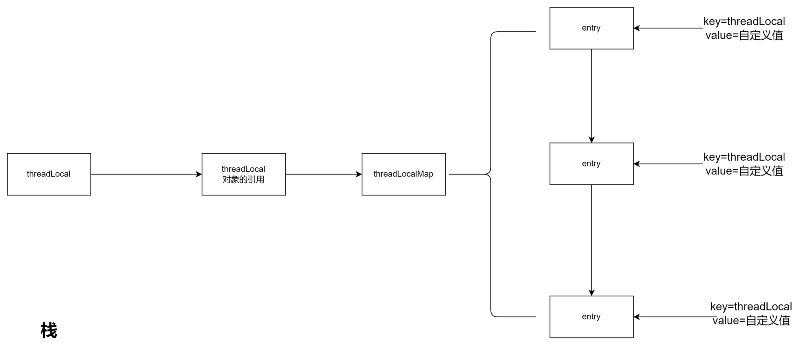

# what

ThreadLocal 提供**线程局部变量**：每个线程访问的是自己的一份副本，天然线程隔离，不需要加锁。

一句话记住实现：数据不在 ThreadLocal 里，而在**每个 Thread 自己的 ThreadLocalMap** 里；ThreadLocal 只是查这张表的 key。



# 核心原理（背这几条）

- 存储结构：`Thread → ThreadLocalMap → Entry[]`，Entry 的 key 是 **ThreadLocal 实例（弱引用）**，value 是强引用。
- hash：`threadLocalHashCode` 每次递增 `0x61c88647`（黄金分割 / Fibonacci 散列），让分布更均匀。
- 冲突：ThreadLocalMap 用**开放地址法（线性探测）**，不是链表。
- 扩容：阈值约为数组长度的 `2/3`，扩容时顺带清理 key 为 null 的 stale entry。
- get/set/remove：先用 `hashCode & (len - 1)` 定位，key 相同则命中，否则往后线性探测；remove 会断开 Entry 并清理 stale 槽位。

# 八股速查

## 1. ThreadLocal 和 synchronized 有什么区别？

- synchronized：时间换空间，多线程串行访问同一份共享变量；
- ThreadLocal：空间换时间，每个线程一份副本，没有竞争。
- 前者解决共享变量的并发安全，后者解决"线程私有状态"的隔离与传递。

## 2. 为什么 key 用弱引用，value 却用强引用？

- key 弱引用：ThreadLocal 实例外部不再使用时可以被回收，避免它一直被线程的 Map 强引用；
- value 强引用：正常使用时需要能取到值。
- 代价是 key 被回收后变成 `key = null` 的 stale Entry，value 仍被 `Thread → Map → Entry → value` 这条链挂着。

## 3. 内存泄漏是怎么产生的？

内存泄漏：已经分配的内存无法释放，导致内存浪费、程序变慢甚至崩溃。

ThreadLocalMap 的 Entry 继承自 WeakReference：key 弱引用、value 强引用。

泄漏的典型场景**不是线程结束**，而是**线程长期存活**（比如线程池里的工作线程）：

1. ThreadLocal 实例被回收后，Entry 的 key 变成 null；
2. 但强引用链还在：`Thread → ThreadLocalMap → Entry → value`；
3. 只要线程不死，value 就无法被 GC，直到后续 get/set/remove 触发 `expungeStaleEntry` 或扩容时才被顺带清理。

线程真的结束时，`threadLocals` 整体不可达，反而会被正常回收。所以规范做法是用完调用 `remove()`，线程池场景尤其重要。

## 4. 为什么推荐 `static final`？

一个 ThreadLocal 实例对应 Map 里的一个 entry。反复 new ThreadLocal 会产生大量 entry，而且容易忘记 remove。声明成 `static final`，全类共用一份。

## 5. InheritableThreadLocal 是什么？有什么坑？

- 它允许子线程在**创建时**继承父线程的值。
- 坑：线程池里的线程是复用的，不会重新创建，所以子线程拿不到任务提交线程的值。
- 解决：手动传递、装饰 Runnable，或用阿里开源的 `TransmittableThreadLocal`（TTL）。

## 6. 线程池里为什么必须 remove？

线程会被复用：上一个任务 set 了值却没清理，下一个任务在同一个线程上会读到**上一个请求的数据**，造成串号、越权、日志错乱。写法必须是 `try { ... } finally { remove(); }`。

# 实战场景

## 场景一：登录用户 / 租户上下文

最典型的用法：在 Filter 或拦截器里解析登录态，之后 Controller、Service、DAO 任意层都能直接拿到当前用户，不用层层传参。

```java
public final class UserContext {
    private static final ThreadLocal<LoginUser> HOLDER = new ThreadLocal<>();

    public static void set(LoginUser user) {
        HOLDER.set(user);
    }

    public static LoginUser get() {
        return HOLDER.get();
    }

    public static void clear() {
        HOLDER.remove();
    }
}
```

```java
// Filter 中
try {
    UserContext.set(parseToken(request));
    chain.doFilter(request, response);
} finally {
    UserContext.clear();   // 必须清理
}
```

多租户系统同理：把 `tenantId` 放进 ThreadLocal，DAO/数据源层统一取值，避免每个方法都带租户参数。

## 场景二：链路追踪 traceId（MDC）

日志框架的 MDC 底层就是一个 `ThreadLocal<Map<String, String>>`。每个请求生成一个 traceId，整条调用链的日志都能带上它。

```java
String traceId = UUID.randomUUID().toString().replace("-", "");
MDC.put("traceId", traceId);
try {
    // 业务逻辑
} finally {
    MDC.clear();
}
```

logback 的 pattern 里用 `%X{traceId}` 输出。注意：异步线程 / 线程池不会自动传递 MDC。

## 场景三：事务与数据库连接

Spring 的 `TransactionSynchronizationManager` 用 ThreadLocal 保存当前线程绑定的 `Connection`、事务状态、同步器等。所以同一线程内的多个 DAO 能共享同一个事务连接。

MyBatis 也是类似：`SqlSessionUtils` 把 `SqlSessionHolder` 放进 `TransactionSynchronizationManager` 的 resources（底层是 ThreadLocal），保证同一事务里用的是同一个 SqlSession。

这也是为什么**事务方法里新开线程，事务会失效**——新线程的 ThreadLocal 是空的，拿不到原线程的连接。

## 场景四：线程不安全的工具类

`SimpleDateFormat` 内部的 `Calendar` 不是线程安全的，多线程共享会解析出错。每个线程一份就能解决：

```java
private static final ThreadLocal<SimpleDateFormat> DATE_FORMAT =
        ThreadLocal.withInitial(() -> new SimpleDateFormat("yyyy-MM-dd HH:mm:ss"));
```

同类问题还有 `DecimalFormat` 等非线程安全工具类。

## 场景五：动态数据源 / 分库分表路由

AOP 在方法执行前把数据源标识放进 ThreadLocal，`AbstractRoutingDataSource.determineCurrentLookupKey()` 从 ThreadLocal 读，决定用哪个库。

```java
public final class DynamicDataSourceHolder {
    private static final ThreadLocal<String> DS = new ThreadLocal<>();

    public static void set(String ds) { DS.set(ds); }
    public static String get() { return DS.get(); }
    public static void clear() { DS.remove(); }
}
```

```java
@Around("@annotation(ds)")
public Object route(ProceedingJoinPoint pjp, DS ds) throws Throwable {
    DynamicDataSourceHolder.set(ds.value());
    try {
        return pjp.proceed();
    } finally {
        DynamicDataSourceHolder.clear();
    }
}
```

## 场景六：框架里的 ThreadLocal

- Spring `RequestContextHolder`：用 `NamedThreadLocal` 存 `RequestAttributes`，任意层都能拿到 request；
- `LocaleContextHolder`：存当前线程的 Locale；
- Logback / Log4j2 的 MDC；
- Spring 事务同步、MyBatis SqlSession 管理等。

可以说：**"同一线程内跨层共享状态"** 的地方，基本都是 ThreadLocal。

# 常见坑

1. **忘记 remove**：线程池复用时读到上一个任务的数据（最严重）。
2. **异步丢失上下文**：`@Async`、`CompletableFuture`、自定义线程池都不会继承普通 ThreadLocal。
3. **InheritableThreadLocal 在池化线程里失效**：线程只创建一次，之后不再继承。
4. **存大对象**：value 是强引用，线程不死就一直不释放。
5. **get() 返回 null 有歧义**：可能是没设置，也可能是设置成了 null；需要区分时用 `containsKey` 或约定不存 null。

# 参考

- JDK8 `ThreadLocal`、`ThreadLocalMap` 源码
- 阿里 `TransmittableThreadLocal`（TTL）
