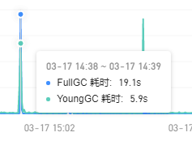
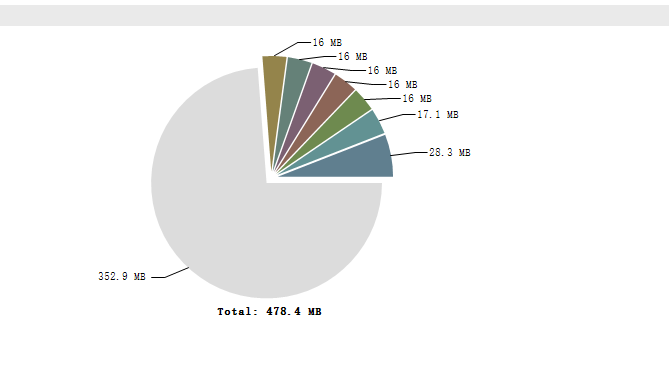
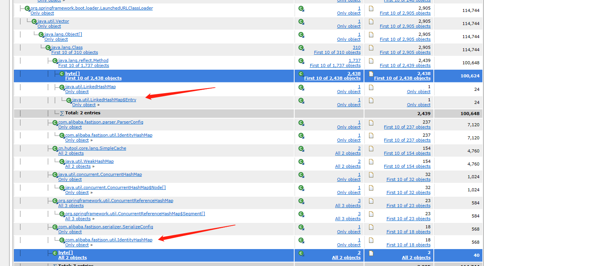
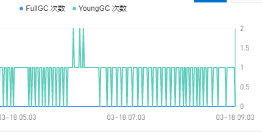
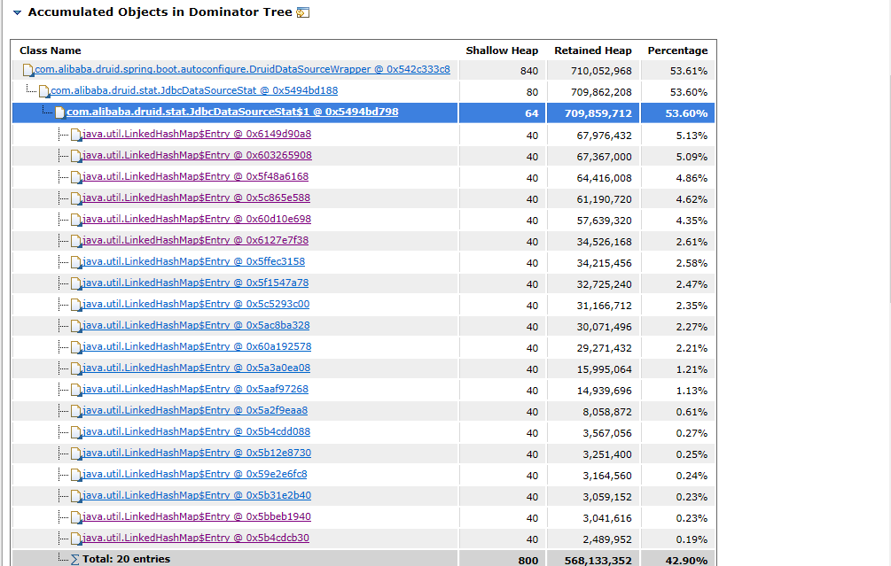

# 内存调优实战复盘

> 记录 2022 年 3 月两次线上问题的排查过程，以及一次 CPU 飙高的定位。
> 统一按「现象 → 定位 → 根因 → 解决 → 验证」复盘，方便以后照着走一遍。

## 背景

- 现象：线上接口大面积超时，Full GC 单次耗时 19 秒；
- JVM 参数：`-Xms10g -Xmx10g`，收集器没改、参数没调优（JDK8 默认 Parallel）；
- GC 表现：young gc 比较频繁，full gc 约每 10 分钟一次，单次 19 秒。

## 案例一：Full GC 19 秒（fastjson 缓存膨胀）

### 现象

监控图（GC 耗时）上可以看到：03-17 14:38~14:39 这一分钟里，**FullGC 耗时 19.1s、YoungGC 耗时 5.9s**。FullGC 单次将近 20 秒，YoungGC 也到了秒级，接口自然大面积超时。



### 定位

1. 先抓堆：`jmap -dump:live,format=b,file=heap.hprof <pid>`；
2. 用 MAT 打开 dump，看 Leak Suspects 和 Dominator Tree：

   

3. 顺着大对象往下找，发现大量 fastjson 相关对象：

   

4. 带着类名去搜，找到 fastjson issue #1286：
   <https://github.com/alibaba/fastjson/issues/1286>

### 根因

issue 标题是《ParserConfig 的 IdentityHashMap 存在内存泄露》：

- `ParserConfig` 用 `IdentityHashMap` 缓存解析用的 `Type`；
- 在 `TypeReference` / 动态 ClassLoader 场景下，key 命中失败，缓存只增不减；
- MAT 里能看到 **237 个 `ParserConfig` / `IdentityHashMap` 实例**，说明 fastjson 被多个 ClassLoader 重复加载，每个类加载器一份静态缓存，叠加起来就是几百份；
- 堆持续膨胀，Full GC 要扫描的对象越来越多，单次停顿被拉长到 19s。

也就是说，问题不是"fastjson 慢"，而是它的**解析缓存无限增长**。

### 解决

当年的做法：把 fastjson 换成 Jackson，先止血。

**为什么当年这么选（补充标注）：**

- **直接原因**：问题出在 fastjson 的解析缓存（`ParserConfig` 的 `IdentityHashMap`），换掉框架等于从根上绕开这条泄漏路径，改动集中在序列化层，见效快；
- **工程成本**：Spring Boot 默认就带 Jackson，不需要引入新依赖，团队和生态都熟，迁移风险相对可控；
- **安全因素**：fastjson 1.x 的 autoType 历史漏洞较多，顺势换成 Jackson 也算一次安全加固；
- **现实约束**：故障期间优先止血；当时 fastjson2 刚发布不久，不适合在故障窗口做框架切换。

**但要明确：这是"规避"，不是"根治"。**

- 如果根因是**动态 ClassLoader 泄漏**（热部署、脚本引擎、CGLIB 等），换 Jackson 只是绕开了这一处缓存，ClassLoader 本身的问题还在；
- 更小的改动其实是：把 `TypeReference` 提成 `static final` 复用、避免每次解析都新建 Type；
- 如果继续用 fastjson，优先考虑升级 fastjson2，而不是停留在 1.x。

**迁移注意**：fastjson 和 Jackson 默认行为不同——null 字段是否输出、未知字段是否报错、`@JSONField` vs `@JsonProperty`、`JSONObject` / `JSONArray` API、日期 / 枚举 / 循环引用等，都需要回归验证。

### 验证

> 原始 GC 对比图已丢失。当时的验证方式是观察替换后 full gc 的频率和单次耗时是否明显回落；如果现在要复现，可以用 `jstat -gcutil` + GC 日志对比替换前后的 FGC 次数和停顿。

## 案例二：YoungGC"针刺"与 Druid 统计膨胀

### 现象

这张图的纵轴不是内存使用率，而是 **GC 次数**：蓝线是 `FullGC 次数`，绿线是 `YoungGC 次数`，纵轴范围 0~2。

- 平时：绿线在 0~1 之间高频抖动，说明 YoungGC 本来就比较频繁；蓝线 FullGC 一直是 0；
- 异常：中间出现两次尖峰冲到 2，像两根"针刺"，很快又回到 1。



判读要点：

- YGC 次数从 1 翻到 2，说明那个采样窗口里多跑了一次 Young GC，是**瞬时分配突增**的形态；
- FullGC 一直是 0，说明这一阶段不是 Full GC 问题，也不是典型内存泄漏（泄漏会表现为老年代阶梯上涨、FullGC 变多）；
- 针刺能自己回落，说明这批对象是短命的，和"持续打满"要区分开。

### 定位

沿用案例一的方法：dump 堆 → MAT 分析 → 定位增长的对象。



### 根因

程序里有大量批插入，且这批数据没办法缓存，带来两个结果：

- **YGC 次数尖峰（针刺）**：一次批处理会在短时间内分配大量对象，采样窗口里 YoungGC 次数从 1 变成 2，处理完又回落；
- **统计 map 膨胀**：MAT 的 Dominator Tree 里，`DruidDataSourceWrapper` 下挂着 `JdbcDataSourceStat`，里面有大量 `LinkedHashMap$Entry`，单这一棵就 retained 约 **710MB（53.6%）**。

也就是说：批插入既放大了瞬时分配（针刺），又让 Druid 的 SQL 统计 map 只增不减（内存被长期占住）。

### 解决

参考：[Druid 内存问题分析](https://blog.csdn.net/zzy7075/article/details/121633165)

方向有两个：

- **关掉 / 限制 Druid 的统计**：不需要 SQL 监控时，关闭 stat filter（如 `spring.datasource.druid.filter.stat.enabled=false`），或定期 reset，避免 `JdbcDataSourceStat` 无限记录；
- **控制批处理规模**：分批提交、及时释放，降低瞬时分配。

单纯加内存只是把爆炸时间往后推。

### 验证（推断）

> 原始监控数据已不在，这里只能按机制推断，不是实测记录。

- `JdbcDataSourceStat` 的 retained：关闭 stat filter 并重启后应明显下降，老年代不再被统计 map 长期占住；
- YoungGC 针刺：取决于是否同时拆分批处理
  - 只关统计、不改批处理 → 内存降下来，但针刺可能仍在；
  - 同时分批提交 → 针刺减少或消失，YGC 次数回到接近基线；
- FullGC：应保持 0。

一句话：**关统计解决"内存被占住"，控制批量解决"针刺"，两件事分开验证。**

如果重来一次，验证就看三个数：

1. `jstat -gcutil <pid> 1000` 里的 YGC 次数和 FGC 次数；
2. MAT 里 `JdbcDataSourceStat` 的 retained size；
3. 监控上 YoungGC 次数曲线的尖峰是否还在。

## 案例三：CPU 升高与线程池 hanging

### 现象

服务器 CPU 明显上升。

### 定位

```bash
# 找进程内的线程
ps -Lfp <pid>
ps -mp <pid> -o THREAD,tid,time
top -Hp <pid>

# 把十进制 tid 转成十六进制
printf "%x\n" <tid>

# 在 jstack 里找对应线程
jstack <pid> | grep -A 20 <十六进制tid>
```

### 根因

线程池 → 创建大量线程 → 申请资源 → 大量线程处于 hanging，既不释放也不关闭。

### 解决

> ⚠️ 待补充：具体的线程池参数、阻塞点、修改方式。

### 验证

> ⚠️ 待补充：修复后线程数、CPU 使用率。

## 复盘

1. 调优的顺序应该是：**先看指标 → 再 dump → 最后定位代码**，不要一上来就调参数；
2. dump 是证据，MAT 只是放大镜，真正定位还是靠"哪个类在涨"；
3. 大部分问题最后都是代码问题，加内存只能延后爆炸时间。

## 常用命令

```bash
# 堆信息
jcmd <pid> GC.heap_info
jstat -gcutil <pid> 1000 10

# 抓堆（:live 会先触发一次 Full GC）
jmap -dump:live,format=b,file=heap.hprof <pid>

# 对象直方图
jmap -histo:live <pid> | head -30
```

生产建议加上：

```bash
-XX:+HeapDumpOnOutOfMemoryError
-XX:HeapDumpPath=/data/dump
```

# 参考

- [JVM.md](JVM.md)（GC 原理与线上排查总流程）
- [内存调优第二篇.md](内存调优第二篇.md)（调优 Checklist）
- [Druid 内存问题分析](https://blog.csdn.net/zzy7075/article/details/121633165)
